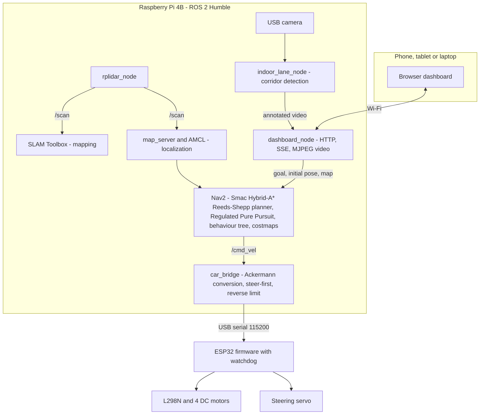
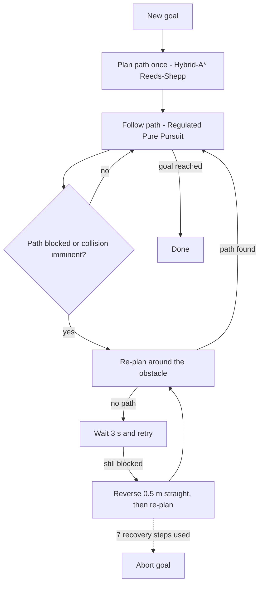

<div align="center">

# 🚗 Vision & LiDAR-Based Autonomous Ground Vehicle

**An affordable Ackermann-steering self-driving car on a modified ride-on chassis — SLAM, localization, reverse-capable navigation, obstacle diversion and a phone-friendly web dashboard, all on ROS 2 Humble.**


-C51A4A?logo=raspberrypi&logoColor=white)


<sub>(a) side view · (b) front, with the camera · (c) top, with the 360° LiDAR</sub>

</div>

---

## Overview

This project turns a children's ride-on car into an autonomous ground vehicle. A **360° 2-D LiDAR** (Slamtec RPLIDAR A1) and a **monocular USB camera** feed a **Raspberry Pi 4B** running **ROS 2 Humble**, while an **ESP32** handles real-time motor and **Ackermann steering** control with a safety watchdog. Computing electronics and high-current motor/servo circuits sit on **separate power domains** so motor spikes cannot brown out the computer.

The car maps its surroundings, localizes itself, and drives to a goal you tap on a map in your browser. Because an Ackermann car cannot turn on the spot, the navigation stack is configured for a car-like vehicle: it plans **kinematically feasible paths that can include reversing** (K-turns), **diverts around obstacles it sees with the LiDAR**, and when it is too close to divert it **waits, then reverses until it can go around**.

Everything runs from one launch command, and the car is operated from a **phone, tablet or laptop browser** — no RViz needed.

## ✨ Features

| | |
|---|---|
| 🗺️ **SLAM mapping** | `slam_toolbox` builds a 2-D occupancy map from the LiDAR; maps are saved as `.pgm` + `.yaml` |
| 📍 **Localization** | AMCL (particle filter) localizes the car on the saved map |
| 🧭 **Ackermann-aware navigation** | Nav2 with a **Smac Hybrid-A\*** planner (**Reeds–Shepp** motion model) and a **Regulated Pure Pursuit** controller — paths respect the car's minimum turning radius |
| 🔁 **Reverse-and-turn (K-turn)** | When the goal is behind the car or there is no room for one forward turn, the car drives forward → reverse → forward |
| 🚧 **Obstacle diversion** | LiDAR obstacles enter the costmap; a blocked path is re-planned around them instead of waiting |
| ⏱️ **Wait-then-reverse recovery** | Too close to divert? Wait 3 s, then reverse in 0.5 m steps and re-plan until a way around exists (custom behaviour tree) |
| 〰️ **Straight driving** | The path is re-planned only when it becomes blocked, with a longer pure-pursuit lookahead — no left-right weaving on straights |
| 🛞 **Steer-first bridge** | `car_bridge` turns the wheels *before* it starts or reverses, caps reverse speed, and converts `cmd_vel` to a steering angle (`δ = atan(L·ω/v)`) |
| 🛡️ **Hardware watchdog** | The ESP32 stops the motors if commands stop arriving |
| 👁️ **Corridor detection** | OpenCV pipeline (line segments → vanishing point → wall/floor lines) draws the drivable floor and a centre path on live video and outputs a steering suggestion |
| 🖥️ **Web dashboard** | Pick a map, set the pose and goals by touch, watch the car, LiDAR, path and camera live, press **STOP** — with an optional PIN |
| 🧪 **Simulation** | Gazebo model of the car and several worlds for development without hardware |

## 🔩 Hardware

| Part | Role |
|---|---|
| Raspberry Pi 4B (8 GB), Ubuntu 22.04 | Main computer: ROS 2, SLAM, Nav2, vision, dashboard |
| ESP32 (ESP-WROOM-32) | Real-time motor + steering control, command watchdog |
| Slamtec RPLIDAR A1 | 360° 2-D scan (12 m range) for mapping, localization and obstacles |
| Zeb Live Pro webcam | Front camera for corridor detection |
| 25 kg·cm digital servo | Ackermann steering |
| 4 × geared DC motors + L298N dual H-bridge | Drive (front pair on channel A, rear pair on channel B) |
| 2 × 6 V 4.5 Ah VRLA batteries in series (12 V) | Actuator power, via a 10 A fuse and master switch |
| LM2596 buck module (~8 V) | Servo supply |
| 5 V / 3 A power bank | Isolated supply for the Raspberry Pi |
| 3 mm / 5 mm Sunboard, 2 mm polycarbonate, 3-D-printed PLA brackets | Lightweight body and canopy |

**Dual-domain power.** Domain 1 (12 V battery → fuse → switch → L298N and servo buck) carries the motor and steering currents. Domain 2 (power bank → Raspberry Pi → USB sensors) is isolated; the two share only a common ground reference at the ESP32/L298N interface.

> ⚠️ **L298N warning:** the L298N is a low-efficiency driver and may be undersized for ride-on-car motors. Read [`docs/GUIDE.md` §4.2](docs/GUIDE.md) before the first power-on and check its temperature during tests. The ESP32 → L298N / servo pin table is in §4.4 and matches `firmware/esp32_car/esp32_car.ino`.

**Vehicle defaults** (all in [`config/real/car.yaml`](config/real/car.yaml) — measure your own car and edit them):

| Parameter | Default | | Parameter | Default |
|---|---|---|---|---|
| Wheelbase *L* | 0.76 m | | Max forward speed | 0.40 m/s |
| Width | 0.64 m | | Max reverse speed | 0.20 m/s |
| Body length | 1.20 m | | Acceleration limit | 0.50 m/s² |
| Max steering angle | ±20° | | LiDAR position | 0.60 m ahead of rear axle, 0.45 m high |
| Min. turning radius *L/tan δ* | ≈ 2.09 m (planner uses ×1.15 ≈ 2.4 m) | | Serial links | ESP32 and LiDAR at 115200 baud |

## 🏗️ System architecture



| Layer | Software |
|---|---|
| Middleware | ROS 2 Humble (DDS) |
| Mapping / localization | `slam_toolbox`, `nav2_map_server`, AMCL |
| Navigation | Nav2: `SmacPlannerHybrid` (Reeds–Shepp), Regulated Pure Pursuit, behaviour-tree navigator, costmap layers |
| Low-level bridge | `car_bridge.py` (ROS ↔ ESP32 serial, dead-reckoned `/odom` + TF) |
| Firmware | Arduino/C++ for ESP32 (`firmware/esp32_car/esp32_car.ino`) |
| Vision | OpenCV, LSD line-segment detector |
| Dashboard | Python standard library only (HTTP + Server-Sent Events + MJPEG) and plain HTML/JS — nothing extra to install |

## 📁 Repository layout

```
self_driving_car/
├── car_bridge.py                  ROS <-> ESP32 bridge: cmd_vel -> steering angle + speed, odometry, TF
├── dashboard_node.py              web dashboard server (map, pose, goals, lidar, car, video)
├── goal_tracker.py                debug helper: prints car pose, goal and distance
├── tf_relay.py, twist_relay.py    simulation helpers (TF and Ackermann cmd_vel relay)
├── self_driving_car/
│   ├── indoor_lane.py             corridor / path detection algorithm
│   ├── indoor_lane_node.py        ROS 2 node: USB camera + detection + video topic
│   └── lane_detector.py, lane_follower.py   painted-lane detector and follower (simulation)
├── perception/lane_detector_video.py        offline lane test on video files
├── launch/                        sim_*, real_*, indoor_lane and dashboard launch files
├── config/
│   ├── real/                      car.yaml (the one file to edit), nav2_params.yaml, slam_mapping.yaml
│   └── nav2/, *.yaml              simulation settings
├── behavior_trees/                navigate_divert_reverse.xml (obstacle logic) and variants
├── firmware/esp32_car/            ESP32 motor + steering firmware
├── description/                   URDF/xacro model for Gazebo
├── worlds/, maps/                 Gazebo worlds and saved maps
├── web/                           dashboard front-end (index.html, app.js, style.css)
└── docs/                          GUIDE.md (full guide), DASHBOARD.md, images/
```

## 🚀 Getting started

**Requirements:** Ubuntu 22.04 with ROS 2 Humble (Raspberry Pi 4B for the real car; a normal PC is enough for the simulation).

```bash
# 1. dependencies
sudo apt update
sudo apt install ros-humble-navigation2 ros-humble-nav2-bringup ros-humble-slam-toolbox \
     ros-humble-nav2-smac-planner ros-humble-teleop-twist-keyboard ros-humble-rplidar-ros \
     ros-humble-gazebo-ros-pkgs ros-humble-gazebo-ros2-control ros-humble-ros2-control \
     ros-humble-ros2-controllers ros-humble-xacro python3-serial python3-opencv
sudo usermod -aG dialout,video $USER      # serial ports + camera; log out and in again

# 2. build
mkdir -p ~/car_ws/src && cd ~/car_ws/src
git clone https://github.com/kirunish14/self_driving_car.git
cd ~/car_ws && source /opt/ros/humble/setup.bash
colcon build --symlink-install
source install/setup.bash
```

**Flash the ESP32:** Arduino IDE → install the *esp32* board package and the *ESP32Servo* library → open `firmware/esp32_car/esp32_car.ino` → board *ESP32 Dev Module* → Upload.

**Configure the car:** measure your vehicle and edit [`config/real/car.yaml`](config/real/car.yaml) (dimensions, steering limit, speed limits, LiDAR position, serial ports). Use stable port names such as `/dev/serial/by-path/...` so the LiDAR and ESP32 never swap. Step-by-step calibration is in [`docs/GUIDE.md` §5](docs/GUIDE.md).

## ▶️ Usage

| Goal | Command |
|---|---|
| **Real** – hardware test (LiDAR + ESP32 + TF) | `ros2 launch self_driving_car real_bringup.launch.py` |
| **Real** – build a map | `ros2 launch self_driving_car real_mapping.launch.py` |
| **Real** – navigate + web dashboard | `ros2 launch self_driving_car real_dashboard.launch.py map:=$HOME/car_maps/my_map.yaml` |
| **Real** – navigate with RViz only | `ros2 launch self_driving_car real_navigation.launch.py map:=$HOME/car_maps/my_map.yaml` |
| **Real** – camera + corridor detection only | `ros2 launch self_driving_car indoor_lane.launch.py device:=0` |
| **Sim** – build a map | `ros2 launch self_driving_car sim_mapping.launch.py` |
| **Sim** – navigate | `ros2 launch self_driving_car sim_navigation.launch.py` |

**Map a place** (drive slowly, close loops):

```bash
ros2 launch self_driving_car real_mapping.launch.py
ros2 run teleop_twist_keyboard teleop_twist_keyboard        # second terminal
mkdir -p ~/car_maps && ros2 run nav2_map_server map_saver_cli -f ~/car_maps/my_map
```

**Drive autonomously from your phone:**

```bash
ros2 launch self_driving_car real_dashboard.launch.py \
  map:=$HOME/car_maps/my_map.yaml lane:=true camera:=0 pin:=1234
```

Then open `http://<car-ip>:8080` (find the IP with `hostname -I`). Options: `pin:=` (ask for a PIN — recommended on shared Wi-Fi), `port:=`, `lane:=true` (start the camera + detection), `camera:=` (device), `nav:=false` (dashboard only).

## 🖥️ Web dashboard

1. **Pick a map** and press *Load map* (maps are found in `~/car_maps/` and the package `maps/`).
2. **Set pose** – touch where the car is and drag toward the direction it faces (same as RViz *2D Pose Estimate*). The chip turns green: *localized*.
3. **Set goal** – touch the destination and drag toward the heading you want on arrival. The car plans and drives there; you see the car, LiDAR points, planned path and distance left.
4. **Camera** shows the corridor-detection video. **STOP** (or `Esc`) cancels the goal and zeroes the speed.

Full details, auto-start at boot and troubleshooting: [`docs/DASHBOARD.md`](docs/DASHBOARD.md).

## 🧠 How it works

**Ackermann kinematics and the bridge.** With wheelbase *L* and steering angle δ the car follows a circle of radius *R = L / tan δ*, so it has a minimum turning radius and cannot rotate in place. Nav2 outputs `(v, ω)`; `car_bridge` converts it to a steering angle `δ = atan(L·ω / v)` (also correct for negative *v*), rate-limits acceleration and steering, waits for the servo to reach the commanded angle before starting or reversing, and sends `C,<speed>,<steer>` lines to the ESP32. It publishes dead-reckoned `/odom`; AMCL corrects the drift.

**Planning and control.** `SmacPlannerHybrid` with the **Reeds–Shepp** motion model plans paths that may contain reverse segments, using the car's real turning radius. **Regulated Pure Pursuit** with `allow_reversing` follows them (forward arc → reverse → forward arc). The final heading is part of the plan, so set goals with a direction.

**Obstacle handling** ([`behavior_trees/navigate_divert_reverse.xml`](behavior_trees/navigate_divert_reverse.xml)):



**Corridor detection** (`self_driving_car/indoor_lane.py`). Long straight segments from the LSD detector vote for a vanishing point; rays from it toward the lower image corners find the wall/floor lines; the result is smoothed over time. The drivable floor, both boundary lines and a centre path are drawn on the video and a steering value in [−1, 1] is published on `/indoor_lane/steer`. *The vision output is advisory — LiDAR navigation drives the car.*

## 🎛️ Tuning cheat sheet

| Symptom | Where / what |
|---|---|
| Reverses too often / never reverses | `reverse_penalty` in `config/real/nav2_params.yaml` (higher = less reversing) |
| Weaves on straight paths | raise `lookahead_dist` (1.2 → 1.4–1.6) |
| Cuts corners | lower `lookahead_dist` |
| "No path" in narrow places | lower `inflation_radius` in the costmaps (0.9 m default) |
| Waits too long / short before reversing | `<Wait wait_duration="3"/>` in the behaviour tree |
| Car too fast / slow | `max_speed`, `v_at_full_cmd` in `config/real/car.yaml` |
| Go back to the old forward-only behaviour | `USE_DIVERT_BT = False` in `launch/real_navigation.launch.py` |

More in [`docs/GUIDE.md`](docs/GUIDE.md) §6, §10 and §11.

## 🛡️ Safety

- Keep a **hardware kill switch** within reach and a **fuse** installed.
- First tests **with the wheels lifted**, then on the floor in an empty area. Nobody sits in the car while it is autonomous.
- Keep `max_speed` low until mapping and navigation are reliable.
- Test the ESP32 watchdog: unplug the USB cable while moving — the motors must stop within 0.4 s.
- The dashboard can drive the car: set a **PIN** and use a private Wi-Fi network or hotspot.

## 🩺 Troubleshooting

| Problem | Fix |
|---|---|
| Dashboard does not open | Same Wi-Fi? Check `hostname -I`; allow the port with `sudo ufw allow 8080/tcp` |
| "map_server is not running" / `map_server` stays `unconfigured` | Launch with a `map:=` path that exists; check `ros2 lifecycle get /map_server` |
| Map shows but no car ("not localized") | Set the initial pose; check `ros2 lifecycle get /amcl` and `ros2 topic hz /scan` |
| LiDAR `SL_RESULT_OPERATION_TIMEOUT` | Wrong port or baud (A1/A2 = 115200, A3/S1 = 256000), another program holding the port, or low USB power — try a powered hub and `/dev/serial/by-path/...` names |
| `ros2 topic echo /scan` prints nothing | Use `ros2 topic echo /scan --qos-reliability best_effort` |
| No camera video | `ros2 topic hz /indoor_lane/image/compressed`; check `ls /dev/video*` and the `video` group |

## 📚 Documentation

- [`docs/GUIDE.md`](docs/GUIDE.md) — complete guide: simulation, hardware, wiring, calibration, mapping, navigation, tuning, safety, reverse-and-turn, obstacle handling
- [`docs/DASHBOARD.md`](docs/DASHBOARD.md) — web dashboard and lane camera

## 🗺️ Roadmap

- Wheel encoders and an IMU for measured odometry (it is currently dead-reckoned from commanded speed)
- Close the loop on the camera (lane keeping) and fuse it with the LiDAR costmap
- A 3-D or multi-plane sensor for obstacles above or below the scan plane
- Outdoor operation with GNSS
- Hardware emergency-stop and a higher-current motor driver
- Quantitative benchmarks from recorded rosbag logs

## 🎬 Demo

[](https://youtu.be/VIDEO_ID)

## 👥 Team

B.E. Mechatronics Engineering, **Chandigarh University**, Mohali, Punjab, India

- Kirunish S
- Jayaraj J P
- Atthish T
- Ngonidzashe C Majaya

## 🙏 Acknowledgements

Built on [ROS 2](https://docs.ros.org), [Nav2](https://docs.nav2.org), [SLAM Toolbox](https://github.com/SteveMacenski/slam_toolbox), [OpenCV](https://opencv.org) and the Slamtec RPLIDAR ROS driver.

## 📄 License

Released under the [Apache License 2.0](LICENSE.md).
